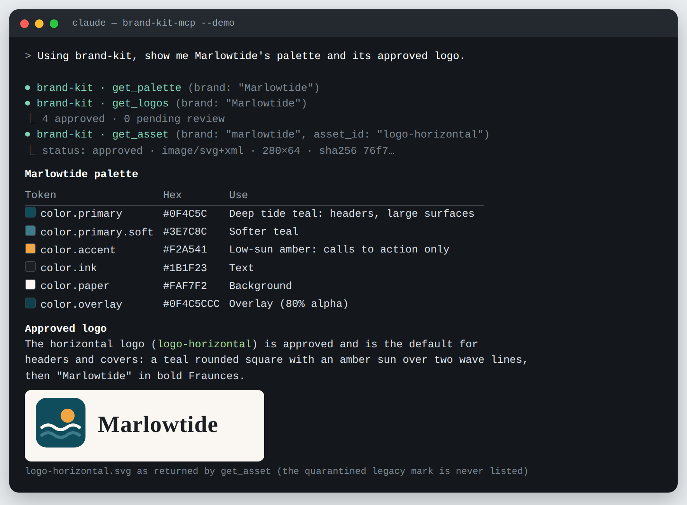

<h1 align="center">brand-kit-mcp</h1>

<p align="center">
  <strong>Dale a tus agentes de IA el manual de marca, no una suposición.</strong><br>
  Un servidor MCP que entrega la paleta, la tipografía, los logos y las reglas de una marca,<br>
  y los exporta como design tokens <a href="https://www.designtokens.org/TR/2025.10/format/">DTCG 2025.10</a>.
</p>

<p align="center">
  <a href="LICENSE"></a>
  <a href="https://pypi.org/project/brand-kit-mcp/"></a>
  
  <a href="https://github.com/Alejandro-Cuautli/brand-kit-mcp/actions/workflows/ci.yml"></a>
</p>

<p align="center"><a href="README.md">Read in English</a></p>

---

## Por qué

[MCP](https://modelcontextprotocol.io) (Model Context Protocol) es el estándar abierto con el que
asistentes como Claude, Cursor o VS Code llaman a herramientas externas. Este servidor es una de ellas.

Los agentes ya redactan la propuesta, arman la presentación y montan la landing. Sin guía eligen
"un azul bonito", una fuente cualquiera y redibujan tu logo como un emoji. El manual de marca
existe, pero vive en un PDF que el agente nunca ve.

**brand-kit-mcp** pone la marca donde el agente puede leerla:

- **Una sola fuente de verdad en archivos.** Cada marca es una carpeta con un `brand.yaml` y sus
  assets. Se revisa en pull requests como cualquier código.
- **Respuestas accionables.** Hex exactos, pilas tipográficas, logos aprobados (embebidos para que
  el modelo los vea) y las reglas escritas.
- **Design tokens incluidos.** Exporta a DTCG 2025.10 (`brand.json`) o a variables CSS para Style
  Dictionary, plugins de Figma o tu propia UI.
- **Seguro por defecto.** Solo lectura, sin base de datos, sin red saliente, sin ejecutar código.
  Los assets en cuarentena nunca se entregan; los pendientes de revisión van marcados.

**Te sirve** si quieres que los agentes usen solo material de marca *aprobado*, guardas (o quieres
guardar) la marca en un repositorio, o necesitas trabajar sin conexión. **No es la herramienta** si
buscas extraer una marca de una web o editar tokens de forma visual; para eso usa una herramienta de
diseño como Figma y copia los valores finales a `brand.yaml`.

## Inicio rápido

Necesitas [uv](https://docs.astral.sh/uv/getting-started/installation/) (`curl -LsSf https://astral.sh/uv/install.sh | sh`).
No hay nada más que instalar: `uvx` descarga el servidor la primera vez que tu cliente lo arranca.

**1. Prueba la marca de demostración** (la ficticia *Marlowtide*) en Claude Code:

```bash
claude mcp add brand-kit -- uvx brand-kit-mcp --demo
```

Y pide: *"Con brand-kit, muéstrame la paleta de Marlowtide y su logo aprobado."*

<p align="center">
  
</p>

**2. Añade tu propia marca.** Una marca es una carpeta con un `brand.yaml` (y, si quieres, sus assets):

```bash
mkdir -p brands/acme
cat > brands/acme/brand.yaml <<'EOF'
name: Acme
tokens:
  color.primary: "#0F4C5C"
  font.family.heading: "Fraunces, Georgia, serif"
guidelines:
  - Nunca deformes el logo.
EOF
uvx brand-kit-mcp validate ./brands
claude mcp remove brand-kit
claude mcp add brand-kit -- uvx brand-kit-mcp --brands-dir "$PWD/brands"
```

Los demás clientes usan el mismo comando. **Claude Desktop** (`claude_desktop_config.json`) y
**Cursor** (`.cursor/mcp.json` en tu proyecto, o `~/.cursor/mcp.json`):

```json
{
  "mcpServers": {
    "brand-kit": {
      "command": "uvx",
      "args": ["brand-kit-mcp", "--brands-dir", "/ruta/absoluta/a/brands"]
    }
  }
}
```

Usa `"args": ["brand-kit-mcp", "--demo"]` para probar primero las marcas de ejemplo.

## Carpeta de marcas

```
brands/
├── marlowtide/
│   ├── brand.yaml
│   └── assets/
│       ├── logo-horizontal.svg
│       ├── logomark.svg
│       └── logomark-256.png
└── marlowtide-trail/        # submarca: parent: marlowtide
    ├── brand.yaml
    └── assets/trail-mark.svg
```

El directorio sale de `--brands-dir`, luego de la variable `BRAND_KIT_DIR` y, si no, de `./brands`.
El nombre de cada carpeta es el slug de la marca (`a-z`, `0-9`, `-`). Las carpetas que empiezan
por `.` o `_` se ignoran.

### `brand.yaml`

```yaml
schema_version: 1
name: Marlowtide
description: Equipo outdoor costero. Tranquilo, práctico y cálido; nunca estridente.
website: https://marlowtide.example    # opcional, solo metadato
parent: null                           # slug de la marca padre (hereda tokens y reglas)

tokens:
  color:
    primary:
      $root:                           # "color.primary" es token Y grupo
        $value: "#0F4C5C"              # entrecomilla siempre los hex: '#' abre un comentario YAML
        $description: Azul marea. Encabezados y superficies grandes.
      soft: "#3E7C8C"                  # color.primary.soft
    accent: "#F2A541"
    overlay: "#0F4C5CCC"               # se aceptan #RGB, #RRGGBB y #RRGGBBAA
  font:
    family:
      heading: "Fraunces, Georgia, serif"
      body: [Inter, system-ui, sans-serif]
    weight:
      bold: 700                        # o una palabra clave: bold, semi-bold...
    size:
      body: 16px                       # px o rem
    line-height:
      body: 1.5
  spacing:                             # "space.*" se acepta como alias
    sm: 8                              # los números sin unidad son px
    lg: 1.5rem
  radius:
    card: 12px

guidelines:
  - El acento ámbar no pasa del 10% de ninguna composición.
  - Nunca pongas el logo sobre fotografía recargada.

assets:
  - id: logomark
    file: assets/logomark.svg          # relativo a la carpeta de la marca; no puede salir de ella
    name: Logomark
    category: logomark                 # logo | logomark | wordmark | icon | illustration |
                                       # pattern | photo | template | other
    status: approved                   # approved | review (por defecto) | quarantined
    tags: [primary, square]
    description: Marca cuadrada para avatares y favicons.
```

Los tokens se pueden escribir anidados (como arriba) o con claves con puntos
(`color.primary.soft: "#3E7C8C"`). Un token puede ser un valor simple o `{ $value, $description }`.

| Estado | Comportamiento |
| --- | --- |
| `approved` | Se entrega con normalidad. |
| `review` | Se entrega con `"approved": false` y un aviso. Se indica a los agentes que no lo usen en entregables finales. |
| `quarantined` | Nunca se entrega ni se cuenta; ni siquiera se reconoce que existe. |

Valida una carpeta antes de publicarla:

```console
$ brand-kit-mcp validate examples/brands
ok  marlowtide: 21 tokens, 5 assets (1 pending review, 1 quarantined)
    note: font.style.tagline is not exported to DTCG (unsupported_type: no DTCG mapping for this token family)
ok  marlowtide-trail (parent: marlowtide): 22 tokens, 1 asset (0 pending review, 0 quarantined)
    note: font.style.tagline is not exported to DTCG (unsupported_type: no DTCG mapping for this token family)
2 brands, 43 tokens, 6 usable assets
```

Un archivo inválido detiene el servidor al arrancar (y `validate` sale con código 2) y lista
todos los problemas a la vez:

```console
$ brand-kit-mcp validate ./brands
brand-kit-mcp: the brands directory is not valid:
  error: acme/brand.yaml: invalid tokens:
           - color.ink: missing value (hint: quote hex colors; an unquoted '#' starts a YAML comment)
           - color.paper: color tokens must be hex strings like '#RGB', '#RRGGBB' or '#RRGGBBAA' (got 'red')
```

## Tools

Todas son de solo lectura (`readOnlyHint: true`).

| Tool | Qué devuelve |
| --- | --- |
| `list_brands` | Todas las marcas: slug, nombre, descripción, padre, hijas, conteos. |
| `get_brand` | Perfil completo: reglas, todos los tokens (con `inherited_from`) y assets utilizables. |
| `get_palette` | Tokens `color.*` con hex, RGB y alfa. |
| `get_typography` | Tokens `font.*` y cada pila tipográfica como lista. |
| `get_logos` | Logos, logomarks, wordmarks e iconos, con `approved: true/false`. |
| `search_assets` | Filtra por `brand`, `category`, `tag`, texto libre `query` y `approved_only`; devuelve facetas. |
| `get_asset` | Metadatos y contenido: PNG/JPEG/WebP hasta 2 MB como imagen MCP, SVG como texto. |
| `export_brand_json` | `brand.json`: tokens DTCG 2025.10, logos, reglas y `omitted`. |
| `export_tokens_css` | Variables CSS en `:root`, con prefijo opcional. |
| `generate_brand_kit` | Kit en markdown para un `document` o una `presentation`, con pares de contraste WCAG. |

Recursos: `brand://{slug}/brand.json`, `brand://{slug}/tokens.css` y `brand://{slug}/kit.md`.

## Exportaciones

### DTCG (`brand.json`)

`export_brand_json` envuelve un árbol DTCG estándar con los logos y las reglas de la marca. Lo que
DTCG no puede expresar **nunca se inventa**: va a `omitted` con un motivo (`unsupported_type`,
`unconvertible_value` o `path_collision`).

```json
{
  "brand_json": "1.0",
  "dtcg": "https://www.designtokens.org/TR/2025.10/format/",
  "generator": "brand-kit-mcp 0.1.0",
  "brand": { "slug": "marlowtide", "name": "Marlowtide", "parent": null },
  "tokens": {
    "color": {
      "primary": {
        "$root": {
          "$type": "color",
          "$value": { "colorSpace": "srgb", "components": [0.0588, 0.298, 0.3608], "hex": "#0F4C5C" },
          "$description": "Deep tide teal. Headers, large surfaces, primary buttons."
        },
        "soft": {
          "$type": "color",
          "$value": { "colorSpace": "srgb", "components": [0.2431, 0.4863, 0.549], "hex": "#3E7C8C" }
        }
      },
      "overlay": {
        "$type": "color",
        "$value": { "colorSpace": "srgb", "components": [0.0588, 0.298, 0.3608], "hex": "#0F4C5C", "alpha": 0.8 }
      }
    },
    "spacing": { "lg": { "$type": "dimension", "$value": { "value": 1.5, "unit": "rem" } } }
  },
  "omitted": [{ "name": "font.style.tagline", "reason": "unsupported_type", "detail": "no DTCG mapping for this token family" }]
}
```

| Nombre del token | `$type` DTCG |
| --- | --- |
| `color.*` | `color` (componentes sRGB, `hex`, `alpha`) |
| `font.family.*` | `fontFamily` |
| `font.weight.*` | `fontWeight` |
| `font.size.*`, `spacing.*`, `space.*`, `radius.*` | `dimension` (`px` / `rem`) |
| `font.line-height.*` | `number` |

En la línea de comandos, `--format dtcg` imprime el árbol de tokens puro (un `.tokens.json`
válido) y `--format brand-json` el documento completo:

```bash
brand-kit-mcp export marlowtide --format dtcg > marlowtide.tokens.json
```

### CSS

```css
/* Marlowtide (marlowtide) design tokens. Generated by brand-kit-mcp 0.1.0; do not edit. */
:root {
  --color-primary: #0F4C5C;
  --color-primary-soft: #3E7C8C;
  --color-accent: #F2A541;
  --font-family-heading: "Fraunces", "Georgia", serif;
  --spacing-lg: 1.5rem;
  --radius-card: 12px;
}
/* Not exported: font.style.tagline (unsupported_type) */
```

## Modo HTTP y Docker

stdio es el modo por defecto. Para un servidor compartido usa streamable HTTP:

```bash
export BRAND_KIT_TOKEN="$(openssl rand -hex 32)"   # opcional; si existe, cada petición lo exige
brand-kit-mcp --transport http --host 127.0.0.1 --port 8000 --brands-dir ./brands
```

El endpoint MCP es `http://127.0.0.1:8000/mcp`; `GET /health` responde sin token. Los clientes
envían `Authorization: Bearer <token>`, por ejemplo:

```bash
claude mcp add --transport http brand-kit http://127.0.0.1:8000/mcp \
  --header "Authorization: Bearer $BRAND_KIT_TOKEN"
```

La imagen Docker corre en modo HTTP con un usuario sin privilegios e incluye las marcas de ejemplo
en `/brands`. Monta tu carpeta encima en solo lectura:

```bash
docker run --rm -p 127.0.0.1:8000:8000 \
  -e BRAND_KIT_TOKEN="$BRAND_KIT_TOKEN" \
  -v "$PWD/brands:/brands:ro" \
  ghcr.io/alejandro-cuautli/brand-kit-mcp:latest
```

| Ajuste | Opción | Variable de entorno | Por defecto |
| --- | --- | --- | --- |
| Carpeta de marcas | `--brands-dir` | `BRAND_KIT_DIR` | `./brands` |
| Transporte | `--transport stdio\|http` | | `stdio` |
| Dirección | `--host` | | `127.0.0.1` |
| Puerto | `--port` | | `8000` |
| Token Bearer (HTTP) | | `BRAND_KIT_TOKEN` | ninguno |
| Cabeceras `Host` permitidas (HTTP) | | `BRAND_KIT_ALLOWED_HOSTS` (separadas por comas) | solo loopback si escucha en loopback |

## Seguridad

- **Solo lectura.** Ninguna tool escribe; no hay base de datos ni acceso de red saliente.
- **Cada archivo en su carpeta.** Toda ruta de asset se resuelve y debe quedar dentro de la carpeta
  de su marca: `..`, rutas absolutas y symlinks que apunten fuera se rechazan al arrancar y se
  vuelven a comprobar en cada lectura. Las carpetas de marca que son symlinks se rechazan.
- **Parseo seguro.** El YAML se lee con el cargador seguro de PyYAML y sin alias. El contenido de
  cada archivo debe coincidir con su extensión.
- **Límites.** `brand.yaml` hasta 1 MiB, assets hasta 50 MiB, imágenes embebidas hasta 2 MB.
- **El SVG es dato.** Los SVG se devuelven como texto, nunca se renderizan. Si contienen scripts o
  manejadores de eventos se marcan para que los sanees antes de usarlos en una web.
- **HTTP.** Escucha en `127.0.0.1` por defecto. Con `BRAND_KIT_TOKEN` definido, cada petición
  necesita ese token Bearer (comparación en tiempo constante). Las respuestas nunca incluyen rutas
  absolutas.

Para reportar una vulnerabilidad, consulta [SECURITY.md](SECURITY.md).

## Ideas

No son compromisos, solo direcciones en estudio. Abre un issue si alguna te importa:

- Rasterizar los logos SVG a PNG en local, para que los modelos que no leen SVG como texto también
  los vean.
- Un comando `lint` y una tool de solo lectura `check_artifact` que señalen colores, fuentes y
  contrastes fuera de marca en CSS, HTML o SVG.
- Más tipos DTCG: sombras, degradados, tipografía compuesta.
- Alcance de marcas por token en modo HTTP para agencias.

## Desarrollo

```bash
python -m venv .venv && . .venv/bin/activate
pip install -e ".[dev]"
pytest && ruff check . && ruff format --check .
```

Consulta [CONTRIBUTING.md](CONTRIBUTING.md) y el [changelog](CHANGELOG.md).

## Autor

Creado por **Alejandro Cuautli**: [synaptic-ai.dev](https://synaptic-ai.dev) ·
[GitHub](https://github.com/Alejandro-Cuautli)

Publicado bajo la [licencia MIT](LICENSE). *Marlowtide* y *Marlowtide Trail* son marcas ficticias
creadas para los ejemplos.
