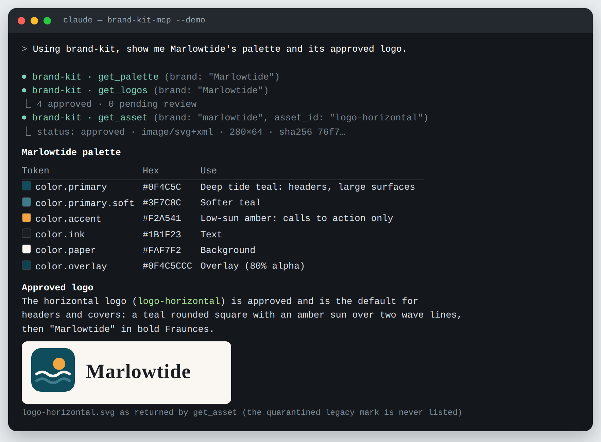

<h1 align="center">brand-kit-mcp</h1>

<p align="center">
  <strong>Give your AI agents the brand book, not a guess.</strong><br>
  An MCP server that serves a brand's palette, typography, logos and rules,<br>
  and exports them as <a href="https://www.designtokens.org/TR/2025.10/format/">DTCG 2025.10</a> design tokens.
</p>

<p align="center">
  <a href="LICENSE"></a>
  <a href="https://pypi.org/project/brand-kit-mcp/"></a>
  
  <a href="https://github.com/Alejandro-Cuautli/brand-kit-mcp/actions/workflows/ci.yml"></a>
</p>

<p align="center"><a href="README.es.md">Leer en español</a></p>

<!-- mcp-name: io.github.Alejandro-Cuautli/brand-kit-mcp -->

---

## Why

[MCP](https://modelcontextprotocol.io) (Model Context Protocol) is the open standard that lets
assistants such as Claude, Cursor or VS Code call external tools. This server is one of those tools.

Agents now write the proposal, build the deck and scaffold the landing page. Left alone they pick
"a nice blue", a random Google font and redraw your logo as an emoji. The brand guidelines exist,
but they live in a PDF the agent never sees.

**brand-kit-mcp** puts the brand where the agent can read it:

- **One source of truth in plain files.** Each brand is a folder with a `brand.yaml` and its assets.
  Review it in pull requests like any other code.
- **Answers agents can act on.** Exact hex values, font stacks, approved logos (embedded so the
  model can actually see them) and the written rules.
- **Design tokens for free.** Export to DTCG 2025.10 (`brand.json`) or CSS custom properties for
  Style Dictionary, Figma plugins or your own UI.
- **Safe by default.** Read-only, no database, no outbound network, no code execution. Assets in
  quarantine are never served; assets pending review are clearly marked.

**Good fit** if you want agents to use only *approved* brand material, you keep brand files in a
repository (or want to), or you need it offline. **Not the tool** if you want to extract a brand
from a live website or edit tokens visually; use a design tool such as Figma for that and copy
the final values into `brand.yaml`.

## Quickstart

You need [uv](https://docs.astral.sh/uv/getting-started/installation/) (`curl -LsSf https://astral.sh/uv/install.sh | sh`).
There is nothing else to install: `uvx` downloads the server the first time your client starts it.

**1. Try the bundled demo brand** (the fictional *Marlowtide*) in Claude Code:

```bash
claude mcp add brand-kit -- uvx brand-kit-mcp --demo
```

Then ask: *"Using brand-kit, show me Marlowtide's palette and its approved logo."*

<p align="center">
  
</p>

**2. Add your own brand.** A brand is a folder with a `brand.yaml` (and, optionally, its assets):

```bash
mkdir -p brands/acme
cat > brands/acme/brand.yaml <<'EOF'
name: Acme
tokens:
  color.primary: "#0F4C5C"
  font.family.heading: "Fraunces, Georgia, serif"
guidelines:
  - Never stretch the logo.
EOF
uvx brand-kit-mcp validate ./brands
claude mcp remove brand-kit
claude mcp add brand-kit -- uvx brand-kit-mcp --brands-dir "$PWD/brands"
```

Other clients run the same command. **Claude Desktop** (`claude_desktop_config.json`) and
**Cursor** (`.cursor/mcp.json` in your project, or `~/.cursor/mcp.json`):

```json
{
  "mcpServers": {
    "brand-kit": {
      "command": "uvx",
      "args": ["brand-kit-mcp", "--brands-dir", "/absolute/path/to/brands"]
    }
  }
}
```

Use `"args": ["brand-kit-mcp", "--demo"]` to try the example brands first.

## Brand folder

```
brands/
├── marlowtide/
│   ├── brand.yaml
│   └── assets/
│       ├── logo-horizontal.svg
│       ├── logomark.svg
│       └── logomark-256.png
└── marlowtide-trail/        # sub-brand: parent: marlowtide
    ├── brand.yaml
    └── assets/trail-mark.svg
```

The directory comes from `--brands-dir`, then the `BRAND_KIT_DIR` environment variable, then
`./brands`. Folder names are the brand slugs (`a-z`, `0-9`, `-`). Folders starting with `.` or `_`
are ignored.

### `brand.yaml`

```yaml
schema_version: 1
name: Marlowtide
description: Coastal outdoor gear. Calm, practical and warm; never loud.
website: https://marlowtide.example    # optional, metadata only
parent: null                           # slug of a parent brand (inherits tokens and guidelines)

tokens:
  color:
    primary:
      $root:                           # "color.primary" is a token AND a group
        $value: "#0F4C5C"              # always quote hex colors: '#' starts a YAML comment
        $description: Deep tide teal. Headers and large surfaces.
      soft: "#3E7C8C"                  # color.primary.soft
    accent: "#F2A541"
    overlay: "#0F4C5CCC"               # #RGB, #RRGGBB and #RRGGBBAA are accepted
  font:
    family:
      heading: "Fraunces, Georgia, serif"
      body: [Inter, system-ui, sans-serif]
    weight:
      bold: 700                        # or a keyword: bold, semi-bold...
    size:
      body: 16px                       # px or rem
    line-height:
      body: 1.5
  spacing:                             # "space.*" is accepted as an alias
    sm: 8                              # bare numbers are px
    lg: 1.5rem
  radius:
    card: 12px

guidelines:
  - Keep the amber accent under 10% of any layout.
  - Never place the logo on busy photography.

assets:
  - id: logomark
    file: assets/logomark.svg          # relative to the brand folder; must stay inside it
    name: Logomark
    category: logomark                 # logo | logomark | wordmark | icon | illustration |
                                       # pattern | photo | template | other
    status: approved                   # approved | review (default) | quarantined
    tags: [primary, square]
    description: Square mark for avatars and favicons.
```

Tokens can be written nested (as above) or with dotted keys (`color.primary.soft: "#3E7C8C"`).
A token can be a plain value or `{ $value, $description }`.

| Status | Behaviour |
| --- | --- |
| `approved` | Served normally. |
| `review` | Served with `"approved": false` and a notice. Agents are told not to use it in final work. |
| `quarantined` | Never served, never counted, not even acknowledged as existing. |

Validate a folder before shipping it:

```console
$ brand-kit-mcp validate examples/brands
ok  marlowtide: 21 tokens, 5 assets (1 pending review, 1 quarantined)
    note: font.style.tagline is not exported to DTCG (unsupported_type: no DTCG mapping for this token family)
ok  marlowtide-trail (parent: marlowtide): 22 tokens, 1 asset (0 pending review, 0 quarantined)
    note: font.style.tagline is not exported to DTCG (unsupported_type: no DTCG mapping for this token family)
2 brands, 43 tokens, 6 usable assets
```

Invalid files stop the server at startup (and make `validate` exit with code 2), listing every
problem at once:

```console
$ brand-kit-mcp validate ./brands
brand-kit-mcp: the brands directory is not valid:
  error: acme/brand.yaml: invalid tokens:
           - color.ink: missing value (hint: quote hex colors; an unquoted '#' starts a YAML comment)
           - color.paper: color tokens must be hex strings like '#RGB', '#RRGGBB' or '#RRGGBBAA' (got 'red')
```

## Tools

All tools are read-only (`readOnlyHint: true`).

| Tool | What it returns |
| --- | --- |
| `list_brands` | Every brand: slug, name, description, parent, children, counts. |
| `get_brand` | Full profile: guidelines, every token (with `inherited_from`), usable assets. |
| `get_palette` | `color.*` tokens with hex, RGB and alpha. |
| `get_typography` | `font.*` tokens plus each font stack as a list. |
| `get_logos` | Logos, logomarks, wordmarks and icons, flagged `approved: true/false`. |
| `search_assets` | Filter by `brand`, `category`, `tag`, free-text `query`, `approved_only`; returns facets. |
| `get_asset` | Metadata plus content: PNG/JPEG/WebP up to 2 MB embedded as an MCP image, SVG as text. |
| `export_brand_json` | `brand.json`: DTCG 2025.10 tokens, logos, guidelines and `omitted`. |
| `export_tokens_css` | CSS custom properties on `:root`, with an optional prefix. |
| `generate_brand_kit` | A markdown kit for a `document` or a `presentation`, with WCAG contrast pairs. |

Resources: `brand://{slug}/brand.json`, `brand://{slug}/tokens.css` and `brand://{slug}/kit.md`.

## Exports

### DTCG (`brand.json`)

`export_brand_json` wraps a standard DTCG token tree with the brand's logos and rules. Values that
DTCG cannot express are **never guessed**: they are listed under `omitted` with a reason
(`unsupported_type`, `unconvertible_value` or `path_collision`).

```json
{
  "brand_json": "1.0",
  "dtcg": "https://www.designtokens.org/TR/2025.10/format/",
  "generator": "brand-kit-mcp 0.1.0",
  "brand": { "slug": "marlowtide", "name": "Marlowtide", "parent": null },
  "tokens": {
    "color": {
      "primary": {
        "$root": {
          "$type": "color",
          "$value": { "colorSpace": "srgb", "components": [0.0588, 0.298, 0.3608], "hex": "#0F4C5C" },
          "$description": "Deep tide teal. Headers, large surfaces, primary buttons."
        },
        "soft": {
          "$type": "color",
          "$value": { "colorSpace": "srgb", "components": [0.2431, 0.4863, 0.549], "hex": "#3E7C8C" }
        }
      },
      "overlay": {
        "$type": "color",
        "$value": { "colorSpace": "srgb", "components": [0.0588, 0.298, 0.3608], "hex": "#0F4C5C", "alpha": 0.8 }
      }
    },
    "font": { "family": { "heading": { "$type": "fontFamily", "$value": ["Fraunces", "Georgia", "serif"] } } },
    "spacing": { "lg": { "$type": "dimension", "$value": { "value": 1.5, "unit": "rem" } } }
  },
  "logos": [{ "id": "logo-horizontal", "category": "logo", "status": "approved", "approved": true, "file": "assets/logo-horizontal.svg", "sha256": "76f7…" }],
  "guidelines": ["…"],
  "omitted": [{ "name": "font.style.tagline", "reason": "unsupported_type", "detail": "no DTCG mapping for this token family" }]
}
```

| Token name | DTCG `$type` |
| --- | --- |
| `color.*` | `color` (sRGB components, `hex`, `alpha`) |
| `font.family.*` | `fontFamily` |
| `font.weight.*` | `fontWeight` |
| `font.size.*`, `spacing.*`, `space.*`, `radius.*` | `dimension` (`px` / `rem`) |
| `font.line-height.*` | `number` |

From the command line, `--format dtcg` prints the plain token tree (a valid `.tokens.json`) and
`--format brand-json` prints the full document:

```bash
brand-kit-mcp export marlowtide --format dtcg > marlowtide.tokens.json
```

### CSS

```css
/* Marlowtide (marlowtide) design tokens. Generated by brand-kit-mcp 0.1.0; do not edit. */
:root {
  --color-primary: #0F4C5C;
  --color-primary-soft: #3E7C8C;
  --color-accent: #F2A541;
  --color-overlay: #0F4C5CCC;
  --font-family-heading: "Fraunces", "Georgia", serif;
  --font-family-body: "Inter", system-ui, sans-serif;
  --font-weight-bold: 700;
  --font-size-body: 16px;
  --spacing-sm: 8px;
  --spacing-lg: 1.5rem;
  --radius-card: 12px;
}
/* Not exported: font.style.tagline (unsupported_type) */
```

## HTTP mode and Docker

stdio is the default. For a shared server, use streamable HTTP:

```bash
export BRAND_KIT_TOKEN="$(openssl rand -hex 32)"   # optional; when set, every request needs it
brand-kit-mcp --transport http --host 127.0.0.1 --port 8000 --brands-dir ./brands
```

The MCP endpoint is `http://127.0.0.1:8000/mcp`; `GET /health` answers without a token. Clients
send `Authorization: Bearer <token>`, for example:

```bash
claude mcp add --transport http brand-kit http://127.0.0.1:8000/mcp \
  --header "Authorization: Bearer $BRAND_KIT_TOKEN"
```

The Docker image runs in HTTP mode as a non-root user and ships the example brands in `/brands`.
Mount your own folder read-only over it:

```bash
docker run --rm -p 127.0.0.1:8000:8000 \
  -e BRAND_KIT_TOKEN="$BRAND_KIT_TOKEN" \
  -v "$PWD/brands:/brands:ro" \
  ghcr.io/alejandro-cuautli/brand-kit-mcp:latest
```

| Setting | Flag | Environment | Default |
| --- | --- | --- | --- |
| Brands folder | `--brands-dir` | `BRAND_KIT_DIR` | `./brands` |
| Transport | `--transport stdio\|http` | | `stdio` |
| Bind address | `--host` | | `127.0.0.1` |
| Port | `--port` | | `8000` |
| Bearer token (HTTP) | | `BRAND_KIT_TOKEN` | none |
| Allowed `Host` headers (HTTP) | | `BRAND_KIT_ALLOWED_HOSTS` (comma-separated) | loopback only when bound to loopback |

## Security

- **Read-only.** No tool writes anything; there is no database and no outbound network access.
- **Files stay in their folder.** Every asset path is resolved and must stay inside its brand
  folder: `..`, absolute paths and symlinks that point outside are rejected at startup, and
  checked again on every read. Symlinked brand folders are rejected.
- **Safe parsing.** YAML is parsed with PyYAML's safe loader, with aliases disabled. File contents
  must match their extension (no `.png` that is really something else).
- **Limits.** `brand.yaml` up to 1 MiB, assets up to 50 MiB, embedded images up to 2 MB.
- **SVG is data.** SVGs are returned as text, never rendered. Files with scripts or event handlers
  are flagged so you can sanitize them before using them on a web page.
- **HTTP.** Binds to `127.0.0.1` by default. With `BRAND_KIT_TOKEN` set, requests need a matching
  Bearer token (constant-time comparison). Outputs never include absolute file paths.

See [SECURITY.md](SECURITY.md) to report a vulnerability.

## Ideas

Not promises, just directions under consideration. Open an issue if one matters to you:

- Rasterize SVG logos to PNG locally, so models that cannot read SVG text can still see them.
- A `lint` command and a read-only `check_artifact` tool that flag off-brand colors, fonts and
  failing contrast in CSS, HTML or SVG.
- More DTCG types: shadows, gradients, composite typography.
- Per-token brand scopes in HTTP mode for agencies.

## Development

```bash
python -m venv .venv && . .venv/bin/activate
pip install -e ".[dev]"
pytest && ruff check . && ruff format --check .
```

See [CONTRIBUTING.md](CONTRIBUTING.md) and the [changelog](CHANGELOG.md).

## Author

Made by **Alejandro Cuautli**: [synaptic-ai.dev](https://synaptic-ai.dev) ·
[GitHub](https://github.com/Alejandro-Cuautli)

Released under the [MIT License](LICENSE). *Marlowtide* and *Marlowtide Trail* are fictional brands
created for the examples.
